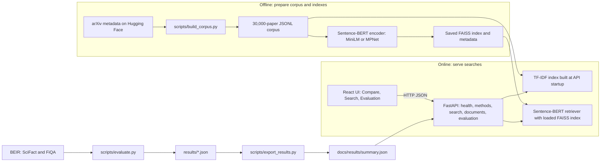

# Semantic Document Search Engine

[](https://github.com/Ram0kr0singh/semantic-search-engine/actions/workflows/ci.yml)

Search academic papers by meaning, with a TF-IDF baseline and Sentence-BERT
retrieval.

An NLP capstone project on information retrieval, benchmark evaluation, and
serving search through a web application.

**Ram Kumar Singh (GitHub: Ram0kr0singh), MCA (AI/ML) capstone project,
K.R. Mangalam University**

## Hero screenshot

A hero screenshot is not included in this checkout. See [Screenshots](#screenshots)
for the current image status.

## What this is

This project searches documents by meaning rather than relying only on exact
keyword overlap. It compares a TF-IDF baseline with Sentence-BERT embeddings
and cosine similarity over a FAISS index. The API returns ranked papers with
scores, and the evaluation harness measures retrieval on two public BEIR
benchmarks. The web application also demonstrates search over a deterministic
30,000-paper arXiv corpus, with a React interface for comparing methods side by
side.

## Key results

Values below are rounded from the committed [evaluation summary](docs/results/summary.json).

| Dataset | Method | nDCG@10 | Recall@100 |
| --- | --- | ---: | ---: |
| SciFact | TF-IDF | 0.6418 | 0.8916 |
| SciFact | BM25 | 0.6663 | 0.8792 |
| SciFact | MiniLM | 0.6451 | 0.9250 |
| SciFact | MPNet | 0.6557 | 0.9417 |
| SciFact | Hybrid (MiniLM) | 0.6850 | 0.9543 |
| SciFact | Hybrid (MPNet) | 0.6861 | 0.9600 |
| SciFact | Hybrid-tuned (MiniLM) | 0.6956 | 0.9153 |
| SciFact | Hybrid-tuned (MPNet) | 0.6909 | 0.9533 |
| FiQA | TF-IDF | 0.1488 | 0.4671 |
| FiQA | BM25 | 0.2223 | 0.5132 |
| FiQA | MiniLM | 0.3687 | 0.7061 |
| FiQA | MPNet | 0.4996 | 0.8197 |
| FiQA | Hybrid (MiniLM) | 0.3321 | 0.6955 |
| FiQA | Hybrid (MPNet) | 0.3991 | 0.7983 |
| FiQA | Hybrid-tuned (MiniLM) | 0.3748 | 0.7061 |
| FiQA | Hybrid-tuned (MPNet) | 0.4996 | 0.8197 |

- On SciFact, hybrid has the highest raw scores, but its nDCG@10 gain over
  BM25 or MPNet is not statistically distinguishable after Holm correction.
  Its Recall@100 gain over BM25 is significant; Hybrid (MiniLM) over MiniLM on
  nDCG@10 is borderline.
- On FiQA, hybrid is significantly worse than its dense component and
  significantly better than BM25. One untested hypothesis is that equal-weight
  RRF lets BM25 ranks displace more useful dense ranks for these paraphrased
  questions.
- Development-tuned weights remove the FiQA loss relative to the dense
  retrievers: the MPNet selection is 0.0 and is identical to MPNet. Neither
  tuned hybrid has a statistically significant nDCG@10 or Recall@100 gain
  over its dense retriever on FiQA.
- On SciFact, tuned hybrids are not statistically distinguishable from their
  equal-weight counterparts on nDCG@10. Hybrid-tuned (MiniLM) improves on
  MiniLM and BM25 for nDCG@10 after Holm correction, while Hybrid-tuned
  (MPNet) does not. Hybrid-tuned (MiniLM) has lower Recall@100 than Hybrid
  (MiniLM) after correction. One untested hypothesis is that its selected
  weight favors early ranking quality over retrieval depth.
- BM25 is the fastest method per query and cheapest to index in these runs.
  Sentence-BERT indexing takes longer, especially MPNet on FiQA.

The fusion design—RRF with k = 60, depth 100, and equal weights—was fixed
before running the benchmarks. A separate weighted-RRF configuration tunes
the BM25 weight on the FiQA `dev` split and the SciFact `train` split. It tests
weights from 0.0 to 1.0 in steps of 0.1, selects by development nDCG@10, and
evaluates each selected configuration once on test. The selected BM25 weights
are FiQA MiniLM 0.1, FiQA MPNet 0.0, SciFact MiniLM 0.7, and SciFact MPNet
0.6.

The committed results are from one laptop run; timings vary run to run.
Hardware note from the summary: **RTX 4060 Laptop GPU, single run per
configuration; timings vary run to run.**

## Screenshots

There are no screenshot files in `docs/images/` in this checkout, so no image
links are listed here.

## Features

- TF-IDF and BM25 keyword retrieval, Sentence-BERT retrieval with cosine
  similarity for normalized dense embeddings and FAISS inner-product search,
  BM25 + Sentence-BERT Hybrid (RRF) retrieval, a cross-encoder reranker over
  fixed first-stage candidates, and a separately tuned weighted hybrid
  evaluation protocol.
- Evaluation harness reporting Recall@1/5/10/100, MRR@10, nDCG@10, index build
  time, and average query latency.
- Registry and loaders for BEIR SciFact and FiQA.
- Persistent Sentence-BERT indexes that validate the model identity and index
  metadata when loaded.
- A sentence-aware, overlapping text chunking utility for long documents; it
  is not currently wired into the search API.
- FastAPI endpoints for health, methods, search, documents, and the evaluation
  snapshot.
- React UI with Compare, Search, and Evaluation views.
- Shareable search settings in the URL, document expansion, and offline/error
  handling.
- Docker Compose setup with CPU as the default and an optional NVIDIA override.

## Architecture



The offline demo workflow streams the arXiv metadata, builds a local JSONL
corpus, encodes documents, and saves the Sentence-BERT FAISS indexes. At API
startup, TF-IDF is built and available saved dense indexes are loaded. Each
dense search embeds its query, searches the loaded index, and returns ranked
papers and snippets.

## Quick start (local, with GPU if available)

Use Python 3.11 or 3.12; the author's environment uses Python 3.12.16. Node.js
and npm are required for the frontend.

Create and activate a virtual environment from the repository root:

```powershell
py -3.12 -m venv .venv
.\.venv\Scripts\Activate.ps1
python -m pip install --upgrade pip
```

Install PyTorch separately: choose the Windows, pip, and Python options at
[pytorch.org](https://pytorch.org/get-started/locally/) and select either the
CPU or CUDA build that matches the machine. Then install the project
requirements:

```powershell
python -m pip install -r requirements.txt
```

The requirements file does not pin a PyTorch build. Install PyTorch separately
first to choose CPU or CUDA; the requirements also install Sentence-Transformers,
which uses PyTorch. The retriever uses CUDA when the installed PyTorch build
can access it and falls back to CPU otherwise. FAISS is installed as
`faiss-cpu`.

Build the demo corpus and both saved Sentence-BERT indexes:

```powershell
python -m scripts.build_corpus
python -m scripts.search_demo --query "how can neural networks understand human language?" --rebuild
python -m scripts.search_demo --model sentence-transformers/all-mpnet-base-v2 --index-dir data/index_mpnet --query "how can neural networks understand human language?" --rebuild
```

Start the API from the repository root:

```powershell
python -m uvicorn backend.app.api.main:app --port 8000
```

Do not add `--reload`: reloading starts another process and reloads the models.
Startup can take tens of seconds while the corpus, indexes, and models load.
Keep the API running, then open a second terminal and start the frontend:

```powershell
cd frontend
npm install
npm run dev
```

Open the local URL printed by Vite. The API is available at
`http://127.0.0.1:8000`.

## Run with Docker

Docker is the portable setup and uses CPU-only PyTorch by default, so the
default image can run without NVIDIA drivers. Local development uses a
separately installed PyTorch CPU or CUDA build; Docker has its own environment
and does not change the local virtual environment. Stop either setup before
starting the other because both use API port `8000`.

Prepare the corpus and indexes on the host from the repository root before
starting Docker. The containers mount `./data` from the host and do not build
the corpus or indexes:

```powershell
python -m scripts.build_corpus
python -m scripts.search_demo --query "how can neural networks understand human language?" --rebuild
python -m scripts.search_demo --model sentence-transformers/all-mpnet-base-v2 --index-dir data/index_mpnet --query "how can neural networks understand human language?" --rebuild
```

Start the UI and API:

```powershell
docker compose up --build
```

By default, the UI is published on port `8080` and the API on port `8000`. The
corpus and indexes are mounted read-only from `./data`. The Hugging Face cache
is persisted under `./data/huggingface-home`, and the committed evaluation
snapshot is mounted read-only.

For optional GPU support, use the override:

```powershell
docker compose -f docker-compose.yml -f docker-compose.gpu.yml up --build
```

This requires NVIDIA drivers and Docker Desktop GPU support. The override
selects CUDA PyTorch wheels and requires rebuilding the image. It has been
validated with `docker compose config`, but has not been tested on GPU
hardware. CPU mode is slower, especially for MPNet.

Stop Docker services with:

```powershell
docker compose down
```

## API

Interactive API documentation is available at
[http://127.0.0.1:8000/docs](http://127.0.0.1:8000/docs) while the API is
running.

| Method and path | Purpose |
| --- | --- |
| `GET /health` | Reports API status, corpus size, methods, and embedding device. |
| `GET /methods` | Lists registered retrieval methods and their readiness. |
| `POST /search` | Searches with an optional method and result count. |
| `GET /documents/{id}` | Returns a full record from the arXiv demo corpus. |
| `GET /evaluation` | Returns the committed evaluation summary. |

`POST /search` accepts `query`, optional `method`, and optional `k`. The
default `k` is 10 and valid values are 1 through 50. For example:

```powershell
curl.exe -X POST http://127.0.0.1:8000/search `
  -H "Content-Type: application/json" `
  --data-raw '{"query":"making models smaller without losing accuracy","method":"sbert-mpnet","k":5}'
```

## Reproducing the evaluation

The evaluation script loads the test splits for SciFact and FiQA. The first
run downloads dataset files and selected Sentence-Transformer model weights.
Run all registered methods on both datasets, saving the query-level values used
for reproducible statistical analysis, then evaluate MPNet explicitly:

```powershell
python -m scripts.evaluate --dataset all --method all --save-per-query
python -m scripts.evaluate --dataset scifact --method bm25 --save-per-query
python -m scripts.evaluate --dataset fiqa --method bm25 --save-per-query
python -m scripts.evaluate --dataset fiqa --method sbert --model sentence-transformers/all-mpnet-base-v2 --save-per-query
python -m scripts.evaluate --dataset scifact --method sbert --model sentence-transformers/all-mpnet-base-v2 --save-per-query
python -m scripts.evaluate --dataset all --method hybrid --model sentence-transformers/all-mpnet-base-v2 --save-per-query
python -m scripts.evaluate --dataset all --method rerank --first-stage bm25 --save-per-query
python -m scripts.evaluate --dataset all --method rerank --first-stage sbert --model sentence-transformers/all-mpnet-base-v2 --save-per-query
python -m scripts.evaluate --dataset all --method rerank --first-stage hybrid --model sentence-transformers/all-mpnet-base-v2 --save-per-query
python -m scripts.tune_hybrid --dataset scifact --model sentence-transformers/all-MiniLM-L6-v2
python -m scripts.tune_hybrid --dataset scifact --model sentence-transformers/all-mpnet-base-v2
python -m scripts.tune_hybrid --dataset fiqa --model sentence-transformers/all-MiniLM-L6-v2
python -m scripts.tune_hybrid --dataset fiqa --model sentence-transformers/all-mpnet-base-v2
```

Reports are written to `results/`. Export validated reports to update the
Evaluation view snapshot:

```powershell
python -m scripts.export_results --hardware-note "RTX 4060 Laptop GPU, single run per configuration; timings vary run to run" --markdown
```

## Statistical analysis

- On SciFact (300 queries), hybrid has the highest raw scores, but its nDCG@10
  gain over BM25 or MPNet is not statistically distinguishable after Holm
  correction. Its Recall@100 gain over BM25 is significant, and Hybrid
  (MiniLM) over MiniLM on nDCG@10 is borderline.
- On FiQA (648 queries), each hybrid is significantly worse than its dense
  component and significantly better than BM25 for nDCG@10 and Recall@100.
- For the separate tuned-hybrid comparison family, both selected weights
  remove the FiQA nDCG@10 loss versus the dense point estimates, but neither
  tuned model has a significant nDCG@10 or Recall@100 gain over its dense
  retriever after correction; MPNet selected weight 0.0 and is identical to
  MPNet. On SciFact, neither tuned hybrid is distinguishable from its
  equal-weight counterpart on nDCG@10. Hybrid-tuned (MiniLM) improves on
  MiniLM and BM25 for nDCG@10 after correction; Hybrid-tuned (MPNet) does
  not. Hybrid-tuned (MiniLM) has lower Recall@100 than Hybrid (MiniLM) after
  correction.

See the [full statistical analysis](docs/analysis/analysis.md) for paired
comparisons, query-level examples, and breakdowns.

The evaluation command's `--save-per-query` flag writes the query-level metric
inputs. After exporting them, regenerate the paired bootstrap, error, and
bucket analysis with:

```powershell
python -m scripts.analyze_results
```

The generated report is [docs/analysis/analysis.md](docs/analysis/analysis.md).
It is intentionally generated only from per-query benchmark runs; do not copy
aggregate numbers into it manually.

The hybrid uses Reciprocal Rank Fusion (RRF), summing `1 / (60 + rank)` for
each component's top 100 results, with deterministic ties resolved by best
component rank and then document ID. This is the formula and `k = 60` reported
by [Cormack, Clarke, and Büttcher (SIGIR 2009)](https://doi.org/10.1145/1571941.1572114).
The BM25 + MiniLM and BM25 + MPNet configurations, RRF constant, and candidate
depth were fixed in advance; they are not tuned on benchmark test queries.
Hybrid index time is the sum of its BM25 and Sentence-BERT component index
times. Query latency measures the end-to-end hybrid search, including both
component searches and fusion.

The tuned hybrid is a separate method: for each dataset and dense model it
scores BM25 weights from 0.0 through 1.0 on a disjoint development split
(FiQA BEIR `dev`, exposed by Hugging Face as `validation`; SciFact `train`), selects the highest mean nDCG@10 (ties: closest
to 0.5, then lower weight), writes the tuning artifact, and evaluates the test
queries once using that selected weight. It does not tune on test metrics.

The cross-encoder reranking protocol was fixed before results were seen. It
uses [`cross-encoder/ms-marco-MiniLM-L-6-v2`](https://huggingface.co/cross-encoder/ms-marco-MiniLM-L6-v2)
(Apache-2.0), whose configuration has a 512-token maximum input length, with
default truncation and batch size 32. It scores `(query, title + text)` pairs
and reranks exactly the top 100 from BM25, MPNet, or equal-weight Hybrid
(MPNet), using only the cross-encoder score (ties: first-stage rank, then
document ID). Reranking only reorders those candidates, so Recall@100 equals
the first-stage Recall@100 by construction and is excluded from rerank
comparisons. Rerank query latency includes first-stage search, cross-encoder
scoring of up to 100 pairs, and final sorting; its index time is the
first-stage index time, with model loading outside the timed index build.

In the latest committed snapshot, indexing FiQA with MPNet took 422.38 seconds
on the noted laptop GPU. Model loading is measured separately from index build
time by the evaluation harness.

## Testing

Run the backend tests from the repository root. Specifying `tests` avoids
pytest traversing the local Hugging Face model cache under `data/`.

```powershell
.\.venv\Scripts\python.exe -m pytest tests
```

The verified result is 71 passing backend tests. Run frontend checks from
`frontend/`:

```powershell
npm test
npm run build
npm run lint
```

The verified frontend test result is 42 passing tests. The production build
and lint checks also pass.

## Project structure

```text
backend/app/
  api/                 FastAPI application, routes, schemas, and runtime state
  data/                arXiv and BEIR loaders, dataset registry, and chunker
  evaluation/          Retrieval metrics and evaluation runner
  retrieval/           Retriever interface, TF-IDF, and Sentence-BERT
scripts/               Corpus, demo, benchmark, and snapshot commands
frontend/src/          React application, views, and API client
docs/results/          Committed benchmark reports and UI summary
tests/                 Backend tests
docker-compose*.yml    Default and optional GPU Compose configurations
```

## Design decisions and limitations

- TF-IDF and Sentence-BERT produce scores on different scales; compare their
  rankings and benchmark metrics, not raw search scores against each other.
- The demo corpus is a deterministic sample of 30,000 papers from the public
  `yacud1/arxiv-bge-base-818k` arXiv metadata dataset. The existing repository
  documentation records its license as CC0-1.0.
- General-purpose embedding models can return topical matches rather than
  intended meaning, particularly for out-of-domain queries.
- The evaluation includes fixed equal-weight RRF hybrid fusion and a fixed
  cross-encoder reranking protocol; neither is exposed through the search API.
- Docker defaults to CPU; local CUDA use requires a compatible PyTorch build
  and GPU environment.
- Timing values are from a single laptop run and will vary with hardware and
  conditions.
- Significance tests use 300 SciFact queries and 648 FiQA queries, with one
  test run per configuration. Tuned weighted-RRF configurations select the
  BM25 weight on a separate development split; no test-query tuning is used.
- PostgreSQL is not used: the demo corpus is small, read-only for search, and
  loaded into memory by the API.
- The text chunker is a standalone utility; the current API searches papers
  from the prepared corpus rather than uploaded documents or passages.

## Future work

- Evaluate score-normalised fusion as an alternative to the implemented
  weighted RRF.
- Add passage-level search over uploaded documents using the existing chunker.
- Add benchmark datasets such as NFCorpus.
- Add search history backed by a database if persistence becomes necessary.

## Acknowledgements and data

This project uses the BEIR benchmark collections, Sentence-Transformers,
FAISS, and Hugging Face datasets and model hosting. The arXiv demo corpus is
built from [`yacud1/arxiv-bge-base-818k`](https://huggingface.co/datasets/yacud1/arxiv-bge-base-818k);
the repository documents the dataset card license as CC0-1.0.

## License

License: not yet specified
