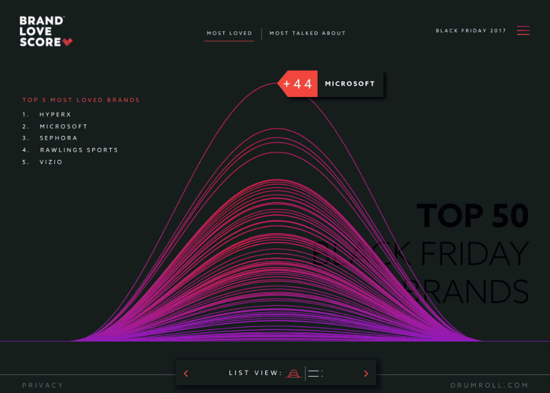
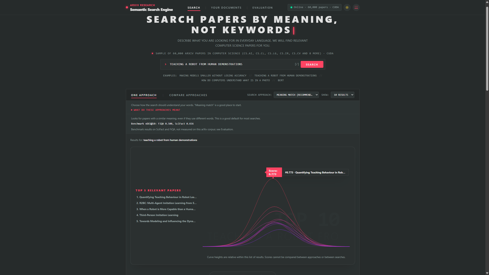
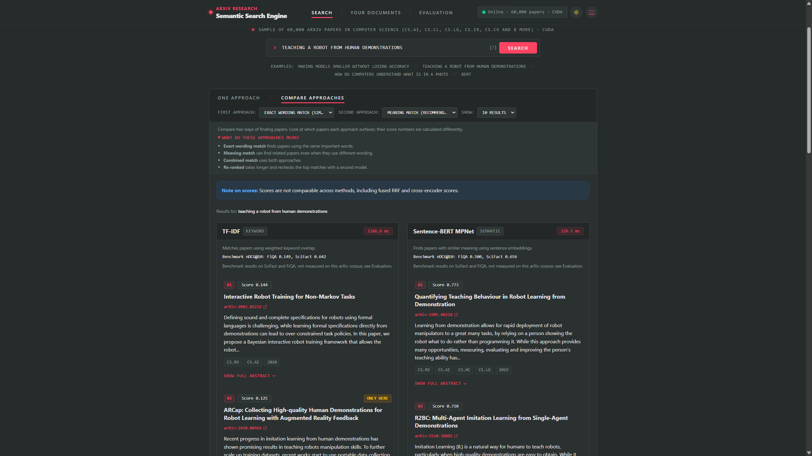
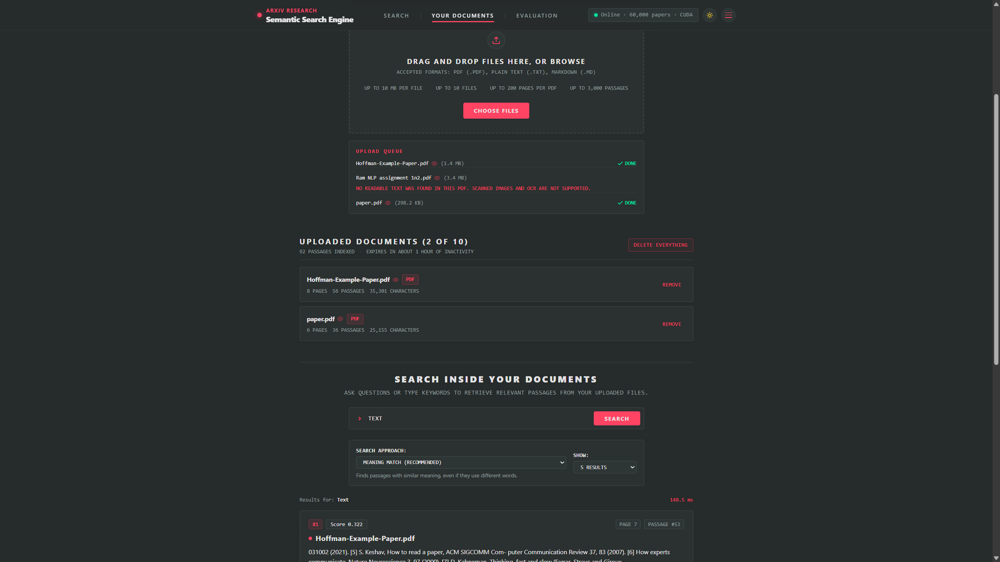
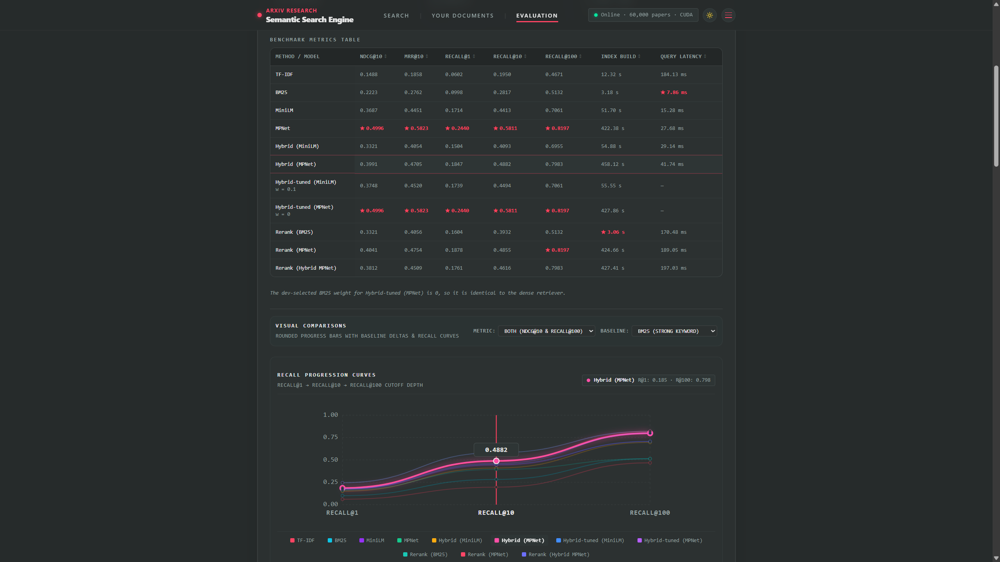
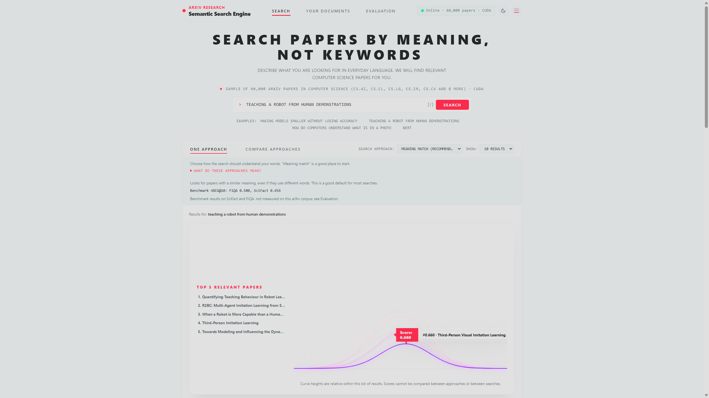
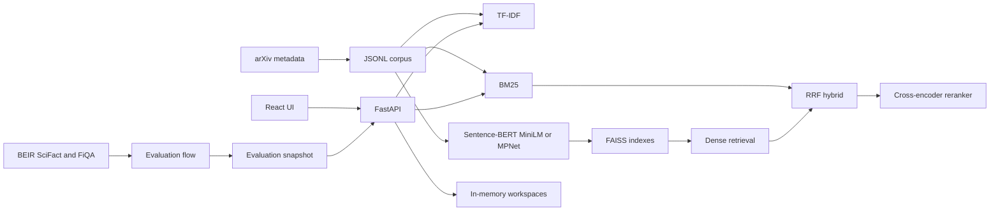

# Semantic Document Search Engine

[](https://github.com/Ram0kr0singh/semantic-search-engine/actions/workflows/ci.yml)

**Search academic papers and uploaded documents with six retrieval methods, side by side.**

An NLP capstone project on information retrieval, benchmark evaluation, and serving search through a web application. It compares TF-IDF, BM25, Sentence-BERT MiniLM and MPNet, RRF hybrid retrieval, and cross-encoder reranking.

**Ram Kumar Singh (GitHub: Ram0kr0singh), MCA (AI/ML) capstone project, K.R. Mangalam University**

## Quick Links

- [Hero screenshot](#hero-screenshot) · [Screenshots](#screenshots) · [Architecture](#architecture) · [Features](#features) · [Key results](#key-results) · [Statistical analysis](#statistical-analysis) · [Tech Stack](#tech-stack) · [Project Structure](#project-structure) · [Getting Started](#getting-started) · [API Reference](#api-reference) · [Reproducing the evaluation](#reproducing-the-evaluation) · [Testing](#testing) · [Security Notes](#security-notes) · [Limitations](#limitations) · [Future work](#future-work) · [Author](#author) · [Acknowledgments](#acknowledgments) · [License](#license)

## Hero screenshot



## Screenshots

Screenshots in [`docs/images/`](docs/images/) are static examples; current corpus size and category wording are supplied at runtime by `/health`.

| Page | Screenshot |
| --- | --- |
| Search results curve | <br><em>Semantic search results ranked by relevance.</em> |
| Compare methods | <br><em>Side-by-side comparison of retrieval methods.</em> |
| Your documents | <br><em>Search within uploaded documents.</em> |
| Evaluation results | <br><em>Benchmark metrics in the evaluation view.</em> |
| Light theme search | <br><em>Search interface in light mode.</em> |

## Architecture



The offline workflow builds a local JSONL corpus and saved Sentence-BERT FAISS indexes. At startup, TF-IDF and BM25 are built and matching dense indexes loaded; the API also exposes equal-weight BM25 + MPNet RRF hybrid search and MPNet cross-encoder reranking when their models are available.

> Benchmark numbers come from SciFact and FiQA, not from the arXiv demo corpus, which has no relevance labels.

## Features

**Search.** Search with TF-IDF, BM25, Sentence-BERT cosine/FAISS retrieval, RRF hybrid retrieval, or a cross-encoder reranker.

**Compare.** The React UI includes Search, Compare, Your documents, and Evaluation views; Compare supports any two distinct available methods.

**Your documents.** Upload PDF, `.txt`, or `.md` files and search with semantic, BM25, hybrid, or reranked retrieval. Results include document names, page numbers when available, scores, safe text-span query highlighting, and expandable passages.

**Evaluation dashboard.** The harness reports Recall@1/5/10/100, MRR@10, nDCG@10, index build time, and average query latency for BEIR SciFact and FiQA.

### Semantic Score Visualization

The interface uses original overlapping Gaussian curves; height reflects scores normalized within the current results. Curves interpolate from hot pink-red (`#ff3d5a`) at Rank 1 to deep violet (`#8a2be2`) at Rank $K$, with synchronized hover, flags, a curve/list switcher, detail drawer, and low-contrast watermark.

#### Design Tokens & Customization Guide

Styling is managed in `frontend/src/index.css`, including `--bl-canvas`, `--bl-surface`, `--bl-surface-floating`, `--bl-accent-hot`, `--bl-accent-cool`, borders, and text colors. `curveMath.ts` interpolates colors; `CurveChart.tsx` uses `duration = 750`, `idx * 20ms`, and respects `prefers-reduced-motion`.

## Key results

Values below are rounded from the committed [evaluation summary](docs/results/summary.json).
These benchmark numbers come from SciFact and FiQA, not the arXiv demo corpus,
which has no relevance labels.

| Dataset | Method | nDCG@10 | Recall@100 |
| --- | --- | ---: | ---: |
| SciFact | TF-IDF | 0.6418 | 0.8916 |
| SciFact | BM25 | 0.6663 | 0.8792 |
| SciFact | MiniLM | 0.6451 | 0.9250 |
| SciFact | MPNet | 0.6557 | 0.9417 |
| SciFact | Hybrid (MiniLM) | 0.6850 | 0.9543 |
| SciFact | Hybrid (MPNet) | 0.6861 | 0.9600 |
| SciFact | Hybrid-tuned (MiniLM) | 0.6956 | 0.9153 |
| SciFact | Hybrid-tuned (MPNet) | 0.6909 | 0.9533 |
| FiQA | TF-IDF | 0.1488 | 0.4671 |
| FiQA | BM25 | 0.2223 | 0.5132 |
| FiQA | MiniLM | 0.3687 | 0.7061 |
| FiQA | MPNet | 0.4996 | 0.8197 |
| FiQA | Hybrid (MiniLM) | 0.3321 | 0.6955 |
| FiQA | Hybrid (MPNet) | 0.3991 | 0.7983 |
| FiQA | Hybrid-tuned (MiniLM) | 0.3748 | 0.7061 |
| FiQA | Hybrid-tuned (MPNet) | 0.4996 | 0.8197 |

- On SciFact, hybrid has the highest raw scores, but its nDCG@10 gain over BM25 or MPNet is not statistically distinguishable after Holm correction. Its Recall@100 gain over BM25 is significant; Hybrid (MiniLM) over MiniLM on nDCG@10 is borderline.
- On FiQA, hybrid is significantly worse than its dense component and significantly better than BM25. One untested hypothesis is that equal-weight RRF lets BM25 ranks displace more useful dense ranks for these paraphrased questions.
- Development-tuned weights remove the FiQA loss relative to the dense retrievers: the MPNet selection is 0.0 and is identical to MPNet. Neither tuned hybrid has a statistically significant nDCG@10 or Recall@100 gain over its dense retriever on FiQA.
- On SciFact, tuned hybrids are not statistically distinguishable from their equal-weight counterparts on nDCG@10. Hybrid-tuned (MiniLM) improves on MiniLM and BM25 for nDCG@10 after Holm correction, while Hybrid-tuned (MPNet) does not. Hybrid-tuned (MiniLM) has lower Recall@100 than Hybrid (MiniLM) after correction. One untested hypothesis is that its selected weight favors early ranking quality over retrieval depth.
- BM25 is the fastest method per query and cheapest to index in these runs. Sentence-BERT indexing takes longer, especially MPNet on FiQA.

The fusion design—RRF with k = 60, depth 100, and equal weights—was fixed before running the benchmarks. A separate weighted-RRF configuration tunes the BM25 weight on the FiQA `dev` split and the SciFact `train` split. It tests weights from 0.0 to 1.0 in steps of 0.1, selects by development nDCG@10, and evaluates each selected configuration once on test. The selected BM25 weights are FiQA MiniLM 0.1, FiQA MPNet 0.0, SciFact MiniLM 0.7, and SciFact MPNet 0.6.

The committed results are from one laptop run; timings vary run to run. Hardware note from the summary: **RTX 4060 Laptop GPU, single run per configuration; timings vary run to run.**

## Statistical analysis

- On SciFact (300 queries), hybrid has the highest raw scores, but its nDCG@10 gain over BM25 or MPNet is not statistically distinguishable after Holm correction. Its Recall@100 gain over BM25 is significant, and Hybrid (MiniLM) over MiniLM on nDCG@10 is borderline.
- On FiQA (648 queries), each hybrid is significantly worse than its dense component and significantly better than BM25 for nDCG@10 and Recall@100.
- For the separate tuned-hybrid comparison family, both selected weights remove the FiQA nDCG@10 loss versus the dense point estimates, but neither tuned model has a significant nDCG@10 or Recall@100 gain over its dense retriever after correction; MPNet selected weight 0.0 and is identical to MPNet. On SciFact, neither tuned hybrid is distinguishable from its equal-weight counterpart on nDCG@10. Hybrid-tuned (MiniLM) improves on MiniLM and BM25 for nDCG@10 after correction; Hybrid-tuned (MPNet) does not. Hybrid-tuned (MiniLM) has lower Recall@100 than Hybrid (MiniLM) after correction.

See the [full statistical analysis](docs/analysis/analysis.md) for paired comparisons, query-level examples, and breakdowns. The evaluation command's `--save-per-query` flag writes query-level metric inputs; regenerate analysis with `python -m scripts.analyze_results`. The hybrid uses `1 / (60 + rank)` across each component's top 100 results; tuned weights use a disjoint development split. Reranking scores the top 100 first-stage candidates and Recall@100 equals first-stage Recall@100 by construction. In the latest committed snapshot, indexing FiQA with MPNet took 422.38 seconds on the noted laptop GPU.

## Tech Stack

| Layer | Technology |
| --- | --- |
| Backend | FastAPI, Uvicorn, HTTPX |
| Retrieval and data | datasets 3.3.2, FAISS CPU, NumPy 2.2.6, pandas 2.2.3, scikit-learn 1.6.1, Sentence-Transformers, tqdm 4.67.1 |
| Frontend | React 19.3.1, React DOM 19.3.1, TypeScript ~7.0.2, Vite 8.3.6, Tailwind CSS 4.3.4 |
| Testing and files | pytest 8.3.5, Vitest 5.1.0, OXLint 1.90.0, pypdf 7.1.0, python-multipart 0.0.33 |

## Project Structure

```text
semantic-search-engine/
├── backend/
│   ├── Dockerfile
│   └── app/
│       ├── api/
│       │   ├── main.py                 # FastAPI application
│       │   ├── routers.py              # Search, health, documents, and evaluation routes
│       │   ├── schemas.py              # API request and response models
│       │   ├── state.py                # Shared application state
│       │   └── workspaces.py           # Private uploaded-document workspaces
│       ├── data/
│       │   ├── arxiv.py                # Demo corpus loading
│       │   ├── beir.py                 # BEIR dataset registry and loading
│       │   ├── chunking.py             # Text chunking utilities
│       │   └── scifact.py              # SciFact dataset support
│       ├── evaluation/
│       │   ├── metrics.py              # Retrieval evaluation metrics
│       │   └── runner.py               # Evaluation execution
│       └── retrieval/
│           ├── base.py                 # Shared retriever interface
│           ├── bm25.py                 # BM25 keyword retrieval
│           ├── hybrid.py               # Hybrid rank fusion
│           ├── rerank.py               # Cross-encoder reranking
│           ├── sbert.py                # Sentence-BERT retrieval
│           └── tfidf.py                # TF-IDF keyword retrieval
├── docs/
│   ├── analysis/
│   │   ├── analysis.md                # Statistical analysis and comparisons
│   │   ├── analysis.json              # Machine-readable analysis
│   │   └── tuning_*.json              # Dataset and model tuning results
│   ├── images/                         # README screenshots and demo
│   └── results/
│       ├── summary.json                # Committed benchmark summary
│       ├── fiqa_*.json                 # FiQA method-level results
│       ├── scifact_*.json              # SciFact method-level results
│       └── per_query/
│           ├── fiqa_*_perquery.json    # FiQA query-level metrics
│           └── scifact_*_perquery.json # SciFact query-level metrics
├── frontend/
│   ├── public/                         # Static public assets
│   ├── src/
│   │   ├── assets/                     # Bundled UI assets
│   │   ├── components/
│   │   │   ├── brandlove/              # Search curves, results, and detail panel
│   │   │   ├── evaluation/             # Evaluation dashboard and charts
│   │   │   ├── EvaluationView.tsx
│   │   │   ├── FilePreviewModal.tsx
│   │   │   ├── Header.tsx
│   │   │   ├── OfflineView.tsx
│   │   │   ├── ResultCard.tsx
│   │   │   ├── ResultColumn.tsx
│   │   │   ├── SearchControls.tsx
│   │   │   └── WorkspaceView.tsx
│   │   ├── App.tsx                     # Main application UI
│   │   ├── api.ts                      # Backend API client
│   │   ├── comparison.ts               # Compare-view logic
│   │   ├── config.ts                   # Frontend configuration
│   │   ├── evaluation.ts               # Evaluation data handling
│   │   ├── main.tsx                    # Frontend entry point
│   │   ├── theme.ts                    # Theme management
│   │   ├── urlState.ts                 # Search URL state helpers
│   │   ├── workspaceStorage.ts         # Workspace token storage
│   │   └── workspaceUtils.tsx          # Workspace UI utilities
│   ├── index.html
│   ├── nginx.conf
│   ├── package.json
│   ├── package-lock.json
│   └── vite.config.ts
├── scripts/
│   ├── analyze_results.py              # Generate statistical analysis
│   ├── build_corpus.py                 # Build the arXiv demo corpus
│   ├── evaluate.py                     # Run retrieval benchmarks
│   ├── export_results.py               # Export validated evaluation results
│   ├── search_demo.py                  # Run a search demo
│   └── tune_hybrid.py                  # Tune hybrid retrieval weights
├── tests/                              # Backend API, retrieval, and evaluation tests
├── .github/workflows/ci.yml            # Continuous integration workflow
├── .env.example                        # Example environment settings
├── docker-compose.yml                  # Default Docker setup
├── docker-compose.gpu.yml              # Optional GPU Docker setup
├── pytest.ini
├── requirements.txt
├── LICENSE
└── README.md
```

Local generated folders such as `data/` and `results/`, along with virtual
environments and dependency caches, are not part of the tracked source tree.

## Getting Started

Use Python 3.11 or 3.12; the author's environment uses Python 3.12.16. Create a virtual environment, install a matching PyTorch CPU or CUDA build separately, then run `python -m pip install -r requirements.txt`. Build the corpus and matching MiniLM/MPNet indexes with `scripts.build_corpus` and `scripts.search_demo`, run `python -m uvicorn backend.app.api.main:app --port 8000`, then `npm install` and `npm run dev` in `frontend/`. Do not use `--reload` because it reloads models.

| Variable | Required | Description |
| --- | --- | --- |
| `API_PORT`, `WEB_PORT`, `VITE_API_BASE_URL`, `API_CORS_ORIGINS` | No | Ports, API base URL, and CORS origins. |
| `ARXIV_CORPUS_PATH`, `ARXIV_MINILM_INDEX_DIR`, `ARXIV_MPNET_INDEX_DIR` | No | Corpus and index locations. |
| `ARXIV_MINILM_MODEL`, `ARXIV_MPNET_MODEL`, `RERANK_MODEL`, `RERANK_ENABLED` | No | Retrieval configuration. |
| `WORKSPACES_ENABLED`, `WORKSPACE_TTL_MINUTES`, `MAX_WORKSPACES`, `MAX_UPLOAD_MB`, `MAX_FILES_PER_WORKSPACE`, `MAX_PDF_PAGES`, `MAX_CHARS_PER_DOCUMENT`, `MAX_PASSAGES_PER_WORKSPACE` | No | Workspace and upload configuration. |
| `TORCH_INDEX_URL`, `TORCH_CUDA_INDEX_URL` | No | CPU and GPU PyTorch wheel indexes. |

Docker uses CPU-only PyTorch by default: prepare the host corpus and indexes, then run `docker compose up --build`. UI and API use ports `8080` and `8000`; optional GPU support uses `docker compose -f docker-compose.yml -f docker-compose.gpu.yml up --build`.

## API Reference

| Method | Path | Description |
| --- | --- | --- |
| `GET` | `/health`, `/methods`, `/evaluation` | Health/configuration, methods, and committed results. |
| `POST` | `/search` | Search with optional method and `k`. |
| `GET` | `/documents/{id}` | Full arXiv record. |
| `POST` | `/workspaces` | Create a temporary workspace. |
| `GET`, `DELETE` | `/workspace` | Read or delete a workspace. |
| `POST` | `/workspace/documents` | Upload a document. |
| `GET`, `DELETE` | `/workspace/documents/{document_id}` | Read or delete a document. |
| `POST` | `/workspace/search` | Search a workspace. |

## Reproducing the evaluation

Run `python -m scripts.evaluate --dataset all --method all --save-per-query`, then the registered BM25, MPNet, hybrid, rerank, and `scripts.tune_hybrid` runs. Export with `python -m scripts.export_results --hardware-note "RTX 4060 Laptop GPU, single run per configuration; timings vary run to run" --markdown`.

## Testing

Run `./.venv/Scripts/python.exe -m pytest tests`; from `frontend/`, run `npm test`, `npm run build`, and `npm run lint`. The verified results are 142 passing backend tests and 98 passing frontend tests.

## Security Notes

Workspaces and indexes are in memory, uploaded originals and extracted text are not saved to disk, and workspaces expire after 60 minutes of inactivity by default. Use the random `X-Workspace-Token` header only; it never appears in URLs. Multipart buffering is cleaned up at request end. Defaults are 20 workspaces, 10 files per workspace, 10 MB per file, 200 PDF pages, 1,000,000 extracted characters, and 3,000 passages. There is no rate limiting yet.

## Limitations

Keyword, dense, fused RRF, and cross-encoder scores are not comparable across methods. The default corpus has 60,000 papers sampled with seed `42`, rather than the full 817,961-row source; benchmarks are independent SciFact/FiQA results. General-purpose embeddings can return topical matches. The API exposes fixed equal-weight MPNet hybrid and MPNet-first-stage reranking, not tuned hybrid. Docker defaults to CPU, timings vary, PostgreSQL is not used, and UI corpus metadata comes from `/health`.

## Future work

- Evaluate score-normalised fusion as an alternative to the implemented weighted RRF.
- Add benchmark datasets such as NFCorpus.
- Add search history backed by a database if persistence becomes necessary.

## Author

Ram Kumar Singh (GitHub: [Ram0kr0singh](https://github.com/Ram0kr0singh)), MCA (AI/ML) capstone project, K.R. Mangalam University.

## Acknowledgments

This project uses the BEIR benchmark collections, Sentence-Transformers, FAISS, and Hugging Face datasets and model hosting. The arXiv demo corpus is built from [`yacud1/arxiv-bge-base-818k`](https://huggingface.co/datasets/yacud1/arxiv-bge-base-818k); the repository documents the dataset card license as CC0-1.0.

## License

MIT. See [LICENSE](LICENSE).
